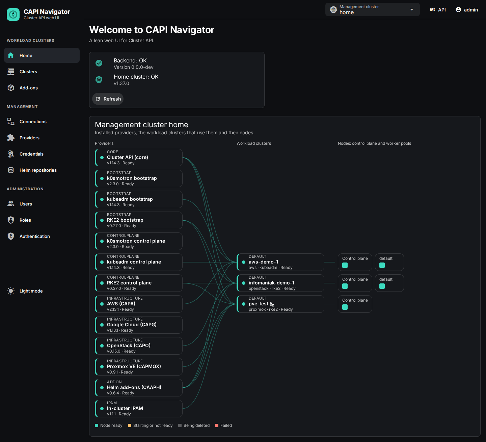

# CAPI Navigator

[](https://github.com/alirionx/capi-navigator/actions/workflows/ci.yaml)

A lean web UI for [Cluster API](https://cluster-api.sigs.k8s.io/) (CAPI). Connect a management
cluster, install the CAPI providers, store cloud credentials and create, operate and delete
Kubernetes clusters on OpenStack, AWS, Google Cloud and Proxmox VE with RKE2, k0s or kubeadm, from forms with a preview of
every change instead of hand-written YAML.



**[Take the UI tour](docs/ui-tour.md)**: screenshots of every step, from the providers to the
node shell, with the Cluster API resources behind each screen.

## Why

Cluster API manages Kubernetes clusters declaratively, but getting started is hard: a management
cluster with cert-manager, the CAPI Operator and several providers, credentials in the format each
provider expects, and a dozen interlinked resources per cluster (`Cluster`, infrastructure cluster,
control plane, machine templates, bootstrap templates, MachineDeployments) whose fields change
between provider releases. Day-2 operations such as upgrades or image changes need template
rotation, and mistakes show up only when machines fail to boot.

CAPI Navigator is a **showcase and entry point** that makes these concepts visible, and a practical
option for **small fleets** (up to about 50 workload clusters per management cluster). It is not a
competitor to Rancher or other platforms.

Everything the app creates for workload clusters is **standard upstream Cluster API**: clusters
stay manageable with `kubectl`, `clusterctl` and other CAPI tools, even after the app is
uninstalled. The app keeps no database; its own state lives in the home cluster as custom
resources, Secrets and ConfigMaps.

### Supported infrastructure and distributions

|                        | Status                                              | Notes                                                                                                                                                                                                     |
| ---------------------- | --------------------------------------------------- | --------------------------------------------------------------------------------------------------------------------------------------------------------------------------------------------------------- |
| OpenStack (CAPO + ORC) | Tested on Infomaniak Public Cloud and Kolla-Ansible | Cloud controller manager and Cinder CSI as presets; bastion host; custom CA for the identity API                                                                                                          |
| AWS (CAPA)             | Tested                                              | AWS cloud controller manager and EBS CSI as presets; dedicated VPC per cluster                                                                                                                            |
| Google Cloud (CAPG)    | Tested                                              | GCP cloud controller manager and persistent disk CSI by ClusterResourceSet; dedicated VPC with Cloud NAT per cluster; no bastion host ([setup](docs/gcp.md))                                              |
| Proxmox VE (CAPMOX)    | Tested on Proxmox VE 9.2                            | API virtual IP held by kube-vip; node address range per cluster; optional LoadBalancer Services through kube-vip; machine sizes per credential; Proxmox CCM and CSI as presets ([setup](docs/proxmox.md)) |
| RKE2                   | Default distribution                                | All day-2 operations                                                                                                                                                                                      |
| k0s (k0smotron)        | Supported                                           | All day-2 operations; needs k0smotron v2.3.0 or later to replace control plane machines ([ADR-0013](docs/adr/0013-k0s-control-plane-replacement.md))                                                      |
| kubeadm                | Experimental                                        | Installed at first boot on stock Ubuntu, Debian or Rocky/Alma images; Calico via ClusterResourceSet ([ADR-0014](docs/adr/0014-kubeadm-on-stock-images.md))                                                |

All distributions use Calico with VXLAN as CNI and run on unmodified cloud images.

## Features

- **Management clusters**: connect by kubeconfig or service account token; an access manifest
  with full or minimal permissions is downloadable. Connection health is checked continuously.
- **Providers**: install, upgrade and remove CAPI providers through the CAPI Operator, with the
  generated YAML shown before applying, and ORC for OpenStack. Shows which clusters use a provider.
- **Credentials**: OpenStack `clouds.yaml` (application credential or password, custom CA), AWS
  access keys, Google Cloud service account keys and Proxmox VE API tokens (with CA and machine sizes), tested against the cloud (services, IAM prerequisites, paging quirks) and used for
  the selection lists of the wizard. Secrets are never sent to the browser.
- **Cluster wizard**: topology (standard, or all-in-one with 1, 3 or 5 nodes), machine sizes, images, root disks, worker
  pools with labels, add-ons, node customization (files, pre/post commands), bastion host, network
  ranges. Every field explains its default and the CAPI field it maps to.
- **Preview before apply**: every change shows the generated objects and a diff, runs as a server
  dry run, reports changes made outside the app as drift, and is applied by server-side apply.
- **Day-2 operations**: scale, change machine size or image, edit node customization, add and
  remove pools, rebuild nodes, upgrade Kubernetes (control plane first, then workers), with a
  rollout plan and one rollout at a time. Machine-affecting changes create new templates instead of
  editing existing ones.
- **Visibility**: live cluster list and status, resource tree, machines with images and addresses,
  events, read-only YAML of every resource, and a dashboard with nodes, workloads, services,
  ingresses and resource usage of the workload cluster.
- **Add-ons** via the Cluster API Add-on Provider for Helm (CAAPH): Helm repositories (HTTP
  and private OCI), chart browser with default values, add-ons assigned to clusters by label,
  release status per cluster, editable CCM/CSI presets and the kured reboot daemon. **Manifest
  add-ons** roll out plain objects (e.g. a `ClusterIssuer`) the same way, with per-cluster
  templates, through a small chart released with the app (mirrorable).
- **Node shell**: a root shell on any node through a temporary privileged pod (operators for
  workload clusters, admins for the management cluster).
- **Kubeconfig**: view and download the admin kubeconfig of a workload cluster (audited).
- **Deletion** with cleanup of load balancers and volumes inside the cluster first, so nothing is
  left in the cloud.
- **REST API** described as OpenAPI 3.1 and generated from the same Zod schemas that validate
  requests; Swagger UI in the app to explore and try it.
- **Sign-in with your identity provider** (OpenID Connect: Okta, Auth0, Dex, Keycloak, Rancher,
  …) next to local users; access comes from the provider's groups mapped to roles, nobody has to be
  created in the app ([docs/oidc.md](docs/oidc.md)).
- **API tokens** for technical users, so pipelines and GitOps tools call the API with their own
  role assignments.
- **Users and roles**: built-in roles viewer, operator and admin plus custom roles from 14
  permissions; role assignments can be limited to management cluster connections and namespaces
  (e.g. operator only in `team-a`). Enforced in the backend; every change is written
  to an audit log.
- Light and dark theme, live updates via server-sent events.

## Architecture

```
Browser (Vue 3 SPA)  ──REST + SSE──▶  NestJS backend  ──Kubernetes API──▶  Management cluster
                                       │                                    ├─ cert-manager
                                       │ own state (CRDs, Secrets,          ├─ CAPI Operator
                                       │ ConfigMaps) in the home cluster    └─ Providers: core, RKE2 / k0s / kubeadm,
                                       │                                       CAPO + ORC, CAPA, CAAPH
                                       ▼                                              │
                                   Transformation                                     ▼
                                   cluster spec → CAPI YAML                 OpenStack / AWS / GCP: workload clusters
                                   (pure functions)                         on stock cloud images
```

- Only the backend talks to Kubernetes; the browser never sees cluster credentials.
- A cluster is described by a **cluster spec** (stored as an annotation on the CAPI `Cluster`).
  Pure functions translate it into CAPI resources; providers and distributions are plugins.
- The **home cluster** holds the app's own state. It can also be one of the management clusters.

See [docs/architecture.md](docs/architecture.md) for how the parts work together: which
resources the app writes, which controllers act on them, and the main flows step by step.

## Quick start

### Try the image with Docker

The app needs only a Kubernetes cluster for its own state (its CRDs, Secrets and ConfigMaps); no
database or volume. Prerequisites: Docker, kubectl, Helm and a kubeconfig for that cluster.

```sh
VERSION=0.8.1
# 1. The app's CRDs and namespace in the cluster
helm show crds oci://ghcr.io/alirionx/charts/capi-navigator --version ${VERSION} \
  | kubectl apply --server-side -f -
kubectl create namespace capi-navigator-system

# 2. The app with your kubeconfig, on http://localhost:3000
docker run --rm -p 3000:3000 \
  -e KUBECONFIG=/kube/config -v ~/.kube/config:/kube/config:ro \
  ghcr.io/alirionx/capi-navigator:${VERSION}

# 3. Sign in as "admin" with the generated password (to be changed at first sign-in)
kubectl -n capi-navigator-system get secret capi-navigator-initial-admin \
  -o jsonpath='{.data.password}' | base64 -d
```

- The container reaches the API server at the address in the kubeconfig, so `127.0.0.1` (kind,
  k3d, Docker Desktop) points to the container itself. For kind, use the internal kubeconfig and
  the kind network: `kind get kubeconfig --name <cluster> --internal > kind.yaml`, then mount
  `kind.yaml` and add `--network kind`.
- The kubeconfig must be readable for the container user (UID 1000) and must not need an exec
  plugin (`aws`, `gcloud`, `kubelogin`): the image has none. The app acts with its permissions.
- Over plain HTTP on another host than `localhost`, add `-e COOKIE_SECURE=false`; otherwise the
  browser drops the session cookie.
- For anything beyond a trial, install the Helm chart (below): it adds RBAC, a service account
  and the in-cluster home cluster access.

### Local development with kind

Prerequisites: Node.js 24 (`.nvmrc`), pnpm via corepack (`corepack enable`), Docker, kind,
kubectl, Helm.

```sh
git clone https://github.com/alirionx/capi-navigator.git
cd capi-navigator
pnpm install
pnpm kind:up        # kind cluster "capi-navigator" with cert-manager and the CAPI Operator
pnpm dev            # backend on :3000, frontend on http://localhost:5173
```

The scripts always use `.kube/kind-capi-navigator.yaml` and ignore any `KUBECONFIG` in your shell,
so a real cluster is never touched by accident. `pnpm kind:down` deletes the cluster.

On first start the backend creates the user `admin`; the password must be changed at first sign-in.
Set `INITIAL_ADMIN_PASSWORD` in `.env.local` (see `.env.example`) before the first start, or read the
generated one:

```sh
kubectl --kubeconfig .kube/kind-capi-navigator.yaml -n capi-navigator-system \
  get secret capi-navigator-initial-admin -o jsonpath='{.data.password}' | base64 -d
```

### Install into a cluster with Helm

Every release publishes the image `ghcr.io/alirionx/capi-navigator:<version>` and the chart as OCI
artifact `oci://ghcr.io/alirionx/charts/capi-navigator`, and attaches the packaged chart to the
[GitHub release](https://github.com/alirionx/capi-navigator/releases). Pick the version there; the
notes of each release also contain these commands with the version filled in.

```sh
VERSION=x.y.z   # a version from the releases page, without the leading "v"
helm install capi-navigator oci://ghcr.io/alirionx/charts/capi-navigator --version ${VERSION} \
  -n capi-navigator-system --create-namespace \
  --set homeClusterAsManagementCluster=true   # optional: use this cluster as management cluster
kubectl -n capi-navigator-system port-forward svc/capi-navigator 8080:80
```

Versions up to 0.7.0 exist only as release attachment: use
`https://github.com/alirionx/capi-navigator/releases/download/v${VERSION}/capi-navigator-${VERSION}.tgz`
in place of the OCI reference and drop `--version`.

The chart uses the image of its own version by default. To run a local build instead (for kind):

```sh
docker build -t capi-navigator:dev .
kind load docker-image capi-navigator:dev --name capi-navigator
helm install capi-navigator deploy/helm/capi-navigator \
  -n capi-navigator-system --create-namespace \
  --set image.repository=capi-navigator --set image.tag=dev
```

**Outbound proxy:** the app reaches GitHub (provider versions, the ORC manifest) and Helm
repositories over the internet. Behind a proxy, set the standard variables with `extraEnv`; the
image enables Node.js proxy support (`NODE_USE_ENV_PROXY=1`). The Kubernetes API is always reached
directly. `NO_PROXY` takes host names, `.domain` suffixes, single IPs and IP ranges
(`10.0.0.0-10.255.255.255`), no CIDRs. A proxy that inspects TLS also needs its CA certificate:

```yaml
# values-proxy.yaml; the ConfigMap proxy-ca (key ca.crt) in the release namespace holds the CA
extraEnv:
  - { name: HTTPS_PROXY, value: http://proxy.example.com:3128 }
  - { name: HTTP_PROXY, value: http://proxy.example.com:3128 }
  - { name: NO_PROXY, value: 'localhost,127.0.0.1,.svc,.cluster.local,.example.internal' }
  - { name: NODE_EXTRA_CA_CERTS, value: /etc/capi-navigator/proxy-ca/ca.crt }
extraVolumes:
  - { name: proxy-ca, configMap: { name: proxy-ca } }
extraVolumeMounts:
  - { name: proxy-ca, mountPath: /etc/capi-navigator/proxy-ca, readOnly: true }
```

The provider controllers get their own proxy per management cluster: on the providers page under
"Outbound proxy", with `NO_PROXY` in Go syntax (CIDRs, no ranges), and a switch per provider (on by
default for CAAPH, CAPA and CAPG). The CAPI Operator downloads the provider components; configure
it through its chart, and repeat the webhook certificate volume, since `volumes` and
`volumeMounts.manager` replace the chart's defaults:

```yaml
# values of the cluster-api-operator chart; the ConfigMap proxy-ca in its namespace holds the CA
env:
  manager:
    - { name: HTTPS_PROXY, value: http://proxy.example.com:3128 }
    - { name: HTTP_PROXY, value: http://proxy.example.com:3128 }
    - { name: NO_PROXY, value: '.svc,.cluster.local,10.0.0.0/8,192.168.0.0/16' }
    - { name: SSL_CERT_FILE, value: /etc/proxy-ca/ca.crt }
volumes:
  - { name: cert, secret: { secretName: capi-operator-webhook-service-cert } }
  - { name: proxy-ca, configMap: { name: proxy-ca } }
volumeMounts:
  manager:
    - { name: cert, mountPath: /tmp/k8s-webhook-server/serving-certs, readOnly: true }
    - { name: proxy-ca, mountPath: /etc/proxy-ca, readOnly: true }
```

The `NO_PROXY` of the operator must contain the service network (or the ClusterIP of
`default/kubernetes`). See [ADR-0029](docs/adr/0029-outbound-proxy-for-app-and-providers.md).

The chart installs the app's CRDs, RBAC and one replica. The initial admin password is read from
the Secret `capi-navigator-initial-admin` (key `password`) in the release namespace, or generated
there on first start.

### Upgrading

Helm installs the CRDs from the chart's `crds/` directory only on `helm install`, never on
`helm upgrade`. Apply the CRDs of the new version first, otherwise new resources (e.g. the
`NavigatorRole` CRD added with role management) are missing and new fields are dropped by the API
server:

```sh
VERSION=x.y.z   # the version to upgrade to
CHART=oci://ghcr.io/alirionx/charts/capi-navigator
helm show crds "$CHART" --version ${VERSION} | kubectl apply --server-side -f -
helm upgrade capi-navigator "$CHART" --version ${VERSION} -n capi-navigator-system --reuse-values
```

### Exposing the app

The chart always creates a Service; an Ingress and a Gateway API `HTTPRoute` are optional and can
be combined with it and with each other:

| Option            | Values                                                                                                                                                                                                                                          | Notes                                                                                |
| ----------------- | ----------------------------------------------------------------------------------------------------------------------------------------------------------------------------------------------------------------------------------------------- | ------------------------------------------------------------------------------------ |
| Service           | `service.type` (`ClusterIP`, `NodePort`, `LoadBalancer`), `service.port`, `service.annotations`, `service.nodePort`, `service.externalTrafficPolicy`, `service.loadBalancerClass`, `service.loadBalancerIP`, `service.loadBalancerSourceRanges` | Annotations configure the cloud load balancer, e.g. Octavia or AWS NLB settings      |
| Ingress           | `ingress.enabled`, `ingress.className`, `ingress.annotations`, `ingress.hosts`, `ingress.path`, `ingress.pathType`, `ingress.tls`                                                                                                               | `networking.k8s.io/v1`; at least one host                                            |
| HTTPRoute         | `httpRoute.enabled`, `httpRoute.parentRefs`, `httpRoute.hostnames`, `httpRoute.path`, `httpRoute.timeouts`, `httpRoute.annotations`                                                                                                             | `gateway.networking.k8s.io/v1`; needs an existing Gateway (at least one `parentRef`) |
| Proxy and cookies | `trustProxy`, `auth.cookieSecure`                                                                                                                                                                                                               | See below                                                                            |

```yaml
# values-ingress.yaml: Ingress with TLS from cert-manager
ingress:
  enabled: true
  className: traefik
  annotations:
    cert-manager.io/cluster-issuer: letsencrypt
  hosts: [capi-navigator.example.com]
  tls:
    - secretName: capi-navigator-tls
      hosts: [capi-navigator.example.com]
```

```yaml
# values-gateway.yaml: HTTPRoute on a shared Gateway that terminates TLS
httpRoute:
  enabled: true
  parentRefs:
    - name: shared-gateway
      namespace: gateway-system
      sectionName: https
  hostnames: [capi-navigator.example.com]
```

```yaml
# values-lb.yaml: cloud load balancer, restricted to an admin network
service:
  type: LoadBalancer
  loadBalancerSourceRanges: [203.0.113.0/24]
```

- **TLS:** sessions use Secure cookies, which browsers store only over HTTPS (or on `localhost`, as
  with `port-forward`). Terminate TLS at the Ingress, the Gateway or the load balancer. Only for
  plain-HTTP test setups, e.g. a LoadBalancer without TLS, set `auth.cookieSecure=false`.
- **Client IPs:** with the Ingress or HTTPRoute enabled, the chart trusts `X-Forwarded-For` from
  private addresses (`trustProxy` defaults to `loopback,linklocal,uniquelocal`), so the login rate
  limit sees the real client. Set `trustProxy` explicitly for other setups (Express "trust proxy"
  syntax).
- **Live updates** use server-sent events (long-lived HTTP responses). The app disables proxy
  buffering (`X-Accel-Buffering: no`); if a gateway cuts the stream after a fixed time, raise its
  timeout, e.g. `httpRoute.timeouts.request: 0s` where supported.

> [!IMPORTANT]
> The app manages clusters and stores cloud credentials. Expose it only via HTTPS (sessions use
> Secure cookies) and give the admin role, or any role with `users.manage`, to few people: they can
> grant every permission, install providers and open root shells on management cluster nodes;
> operators open root shells on workload cluster nodes.

## Using the app

1. **Connections**: add the management cluster (the kind cluster as **Home cluster**, or another
   cluster with the access manifest from `deploy/management-cluster/` and its service account
   token).
2. **Providers**: install ORC (for OpenStack) and the providers from the catalog: core, the
   bootstrap and control plane providers of your distribution, CAPO, CAPA, CAPG and/or CAPMOX (with
   the in-cluster IPAM provider), and CAAPH.
3. **Credentials**: upload the `clouds.yaml` of an OpenStack application credential, enter an AWS
   access key, upload a Google Cloud service account key ([setup](docs/gcp.md)) or enter a Proxmox
   VE API token ([setup](docs/proxmox.md)); run the test.
4. **Clusters → Create cluster**: walk through the wizard, check the preview and create. The
   resource tree and the events show the progress; the cluster is ready after a few minutes.
5. **Day-2**: the tabs of a cluster offer configuration changes (always with preview), the
   dashboard, the node shell, add-ons and the YAML of every resource.
6. **Add-ons**: add Helm repositories (admins), then create add-ons that select clusters by label.
7. **Users and roles**: create users and give them role assignments, everywhere or limited to
   connections and namespaces (e.g. operator in `team-a`); custom roles are combined from 14
   permissions on the **Roles** page. Every user can read everything; limits apply to actions.
   With an OpenID Connect provider (set up under **Administration → Authentication**), map its
   groups to role assignments in **Users → OpenID Connect groups** instead of creating people
   ([docs/oidc.md](docs/oidc.md)).
8. **API**: the REST API is described as OpenAPI 3.1 at `/api/openapi.json` and can be tried in
   Swagger UI at `/api/docs` (user menu → API documentation), with the session of the browser.
   The description is also committed as [docs/api/openapi.json](docs/api/openapi.json).

### Using the API from scripts and pipelines

Scripts, CI pipelines and GitOps tools use API tokens of **technical users**: in **Users**, add a
user with "API only" and give it a role assignment (e.g. operator in `home/team-a`), then generate
a token with the key button. The token (`capin_…`) is shown once; it acts with the role
assignments of the technical user, expires after at most 365 days and can be revoked at any time.

```sh
TOKEN=capin_…   # from the user management
curl -H "Authorization: Bearer $TOKEN" https://capi-navigator.example.com/api/connections/home/clusters
```

Requests with a token need no CSRF header, cannot manage users, roles or tokens and are audited
with the token name. Swagger UI accepts a token under "Authorize".

## Where configuration lives

| What                                                                                                               | Where                                                                                                                                            | When it is set                 | Who changes it                                             |
| ------------------------------------------------------------------------------------------------------------------ | ------------------------------------------------------------------------------------------------------------------------------------------------ | ------------------------------ | ---------------------------------------------------------- |
| Versions: providers, Kubernetes versions, preset charts, Calico (with checksum), containerd/runc, node shell image | [versions.yaml](versions.yaml), generated into `packages/shared/src/versions.generated.ts`                                                       | At build time, per app version | Developers, see [docs/maintenance.md](docs/maintenance.md) |
| Schemas and types (cluster spec, API requests, CRDs), all as Zod                                                   | `packages/shared/src/`                                                                                                                           | At build time                  | Developers                                                 |
| Operation of the backend: app namespace, node shell image, port, sessions, initial admin                           | Environment variables, validated in `apps/backend/src/config/config.ts`; set through the Helm values in `deploy/helm/capi-navigator/values.yaml` | At deployment                  | Operators (Helm)                                           |
| Runtime settings: preset overrides, Helm repositories, connections, credentials, users, roles, API tokens          | ConfigMaps, custom resources and Secrets in the home cluster                                                                                     | During operation, in the UI    | Users with the matching permission                         |
| Large backend-only artifacts: Calico manifest                                                                      | `apps/backend/assets/`                                                                                                                           | At build time                  | Developers                                                 |
| UI texts                                                                                                           | `apps/frontend/src/i18n/`                                                                                                                        | At build time                  | Developers                                                 |

Versions (in `versions.yaml`, generated into the code) and domain defaults are fixed per app version because each app version is tested with them; values
that differ per installation are deployment settings; what admins change while the app runs is
stored in the home cluster (the app has no database).

### Environment variables

| Variable                                        | Default                 | Description                                                                                                                      |
| ----------------------------------------------- | ----------------------- | -------------------------------------------------------------------------------------------------------------------------------- |
| `PORT`, `HOST`                                  | `3000`, `0.0.0.0`       | Listen address of the backend                                                                                                    |
| `NAVIGATOR_NAMESPACE`                           | `capi-navigator-system` | Namespace of the app's own state in the home cluster                                                                             |
| `STATIC_DIR`                                    | –                       | Serve the built frontend from this directory (set in the image)                                                                  |
| `INITIAL_ADMIN_PASSWORD`                        | –                       | Password of the initial admin; otherwise the Secret `capi-navigator-initial-admin`                                               |
| `SESSION_TTL_HOURS`                             | `8`                     | Absolute session lifetime                                                                                                        |
| `COOKIE_SECURE`                                 | `true`                  | Secure flag of the session cookie                                                                                                |
| `TRUST_PROXY`                                   | `loopback`              | Express trust proxy setting, needed behind an ingress                                                                            |
| `API_DOCS_ENABLED`                              | `true`                  | Serve `/api/openapi.json` and Swagger UI at `/api/docs` (both public; Helm value `apiDocs.enabled`)                              |
| `LOGIN_RATE_LIMIT`, `LOGIN_RATE_WINDOW_MINUTES` | `10`, `15`              | Failed logins per client and user within the window                                                                              |
| `AUDIT_RETENTION_DAYS`                          | `90`                    | Retention of audit events                                                                                                        |
| `NODE_SHELL_IMAGE`                              | `alpine:3.24`           | Image of the node shell pod, e.g. a registry mirror                                                                              |
| `PUBLIC_URL`                                    | –                       | Public URL of the app; needed for OpenID Connect, which is set up under Administration → Authentication (Helm value `publicUrl`) |
| `LOG_LEVEL`, `LOG_JSON`                         | `log`, `true`           | Log level; JSON logs by default                                                                                                  |
| `POD_NAME`                                      | host name               | Identity of the replica for leader election                                                                                      |
| `KUBECONFIG`                                    | in-cluster              | Access to the home cluster in local development                                                                                  |
| `HTTPS_PROXY`, `HTTP_PROXY`, `NO_PROXY`         | –                       | Outbound proxy for GitHub and Helm repositories (`NODE_USE_ENV_PROXY=1` in the image); see "Install into a cluster with Helm"    |
| `NODE_EXTRA_CA_CERTS`                           | –                       | Additional CA certificates, e.g. of a proxy that inspects TLS                                                                    |

## Technology

| Area              | Technology                                                                                                                                                                              | Why                                                                                                  |
| ----------------- | --------------------------------------------------------------------------------------------------------------------------------------------------------------------------------------- | ---------------------------------------------------------------------------------------------------- |
| Backend           | Node.js 24, [NestJS](https://nestjs.com), [@kubernetes/client-node](https://github.com/kubernetes-client/javascript)                                                                    | Modules per domain, guards for permissions, watches and server-side apply against the Kubernetes API |
| Frontend          | [Vue 3](https://vuejs.org), [Vite](https://vite.dev), [Pinia](https://pinia.vuejs.org), [Vuetify 3](https://vuetifyjs.com), [Monaco Editor](https://microsoft.github.io/monaco-editor/) | Accessible components with light/dark themes; read-only YAML views and the Helm values editor        |
| Shared model      | TypeScript (strict), [Zod](https://zod.dev)                                                                                                                                             | One schema per entity for form validation, API validation, types and the CRDs' OpenAPI schemas       |
| Transformation    | Pure functions in `packages/shared`                                                                                                                                                     | Same spec, byte-identical YAML; every topology and distribution has snapshot tests                   |
| State             | CRDs (`navigator.capi-navigator.io/v1alpha1`), Secrets and ConfigMaps in the home cluster                                                                                               | No database; the backend stays stateless                                                             |
| Live updates      | Kubernetes watches → server-sent events                                                                                                                                                 | Lists and status update without polling                                                              |
| Cluster lifecycle | Cluster API, CAPI Operator, CAPO + ORC, CAPA, RKE2/k0smotron/kubeadm providers, CAAPH                                                                                                   | Upstream only; clusters stay manageable without the app                                              |
| Container         | Multi-stage build on `node:24-bookworm-slim`, non-root                                                                                                                                  | One image serves API and frontend                                                                    |
| Tests             | Vitest (unit, snapshot), Playwright (end-to-end), kind (integration)                                                                                                                    | From pure transformations to the UI against a real management cluster                                |

## Development

### Commands

| What                                                                                                                                  | Command                                              |
| ------------------------------------------------------------------------------------------------------------------------------------- | ---------------------------------------------------- |
| Install all workspaces                                                                                                                | `pnpm install`                                       |
| Backend and frontend in watch mode                                                                                                    | `pnpm dev`                                           |
| Lint and format check                                                                                                                 | `pnpm lint`                                          |
| Type check                                                                                                                            | `pnpm typecheck`                                     |
| Unit and snapshot tests                                                                                                               | `pnpm test`                                          |
| Backend unit tests with the coverage threshold (70 % lines, as in CI)                                                                 | `pnpm test:coverage`                                 |
| Integration tests against kind (own throwaway namespace; opt-in read-only cloud tests with `OPENSTACK_CLOUDS_YAML=…` or `AWS_LIVE_*`) | `pnpm test:int`                                      |
| End-to-end tests (first time: `pnpm exec playwright install chromium`; with `E2E_ADMIN_PASSWORD=…`)                                   | `pnpm test:e2e`                                      |
| Screenshots for the [UI tour](docs/ui-tour.md) (read-only, needs running workload clusters)                                           | `pnpm docs:screenshots`                              |
| kind cluster as home and management cluster                                                                                           | `pnpm kind:up` / `pnpm kind:down`                    |
| Dex with test users as OpenID Connect provider in kind (restart `pnpm dev` afterwards; e2e with `E2E_OIDC=1`)                         | `pnpm dex:up` / `pnpm dex:down`                      |
| Regenerate / install the app's CRDs from the Zod schemas                                                                              | `pnpm crds:generate` / `pnpm crds:install`           |
| Regenerate the pinned versions / node script templates after editing them                                                             | `pnpm versions:generate` / `pnpm templates:generate` |
| Report newer versions of `versions.yaml`, Actions and Docker images (needs Docker)                                                    | `pnpm versions:report`                               |
| Regenerate the committed OpenAPI document from the routes and Zod schemas                                                             | `pnpm openapi:generate`                              |
| Scan the Git history and the working tree for secrets with gitleaks, e.g. before pushing (needs Docker; rules in `.gitleaks.toml`)    | `pnpm secrets:scan`                                  |
| Third-party notices and license gate (also part of the image build)                                                                   | `pnpm notices:generate`                              |
| Container image                                                                                                                       | `docker build -t capi-navigator .`                   |

### Repository layout

```
apps/backend/       NestJS backend: modules per domain, Kubernetes access, plugins, tests
apps/frontend/      Vue 3 app: views, components, Pinia stores, i18n
packages/shared/    Zod schemas, catalogs, transformation (cluster spec → CAPI YAML), presets
deploy/helm/        Helm chart incl. CRDs
deploy/crds/        Generated CRDs of the app
deploy/management-cluster/  Access manifests for management clusters (full and minimal)
docs/               Requirements, architecture overview, ADRs, maintenance guide, version report
e2e/                Playwright end-to-end tests
scripts/            kind, development, integration test and version report helpers
versions.yaml       Every version the app pins (providers, Kubernetes, charts, runtime, images)
```

### Updating versions

All versions the app pins live in [versions.yaml](versions.yaml); `pnpm versions:report` shows
which newer versions exist in [docs/versions-report.md](docs/versions-report.md). Updating is a
deliberate, manual step with tests and, for providers, a live check. The procedure, the couplings
between versions and a checklist are in **[docs/maintenance.md](docs/maintenance.md)**.

### Releases

CI ([ci.yaml](.github/workflows/ci.yaml)) runs lint, type check, tests with the coverage
threshold, the Helm chart check, the integration tests on kind and an image build for every push
to `main` and every pull request. Nothing is published by CI.

A release is published by pushing a version tag `vX.Y.Z`
([release.yaml](.github/workflows/release.yaml)). It checks that the tag matches `Chart.yaml`,
pushes the image `ghcr.io/alirionx/capi-navigator` with the tags `X.Y.Z`, `X.Y` and `latest`, and
creates the GitHub release with `capi-navigator-X.Y.Z.tgz`, its SHA-256 checksum and notes with
the install and upgrade commands. The chart of the manifest add-ons
([capi-navigator-manifests](deploy/helm/capi-navigator-manifests/README.md), FP-30) is published
next to it with the same version; its `Chart.yaml` stays at `0.0.0-dev`, the workflow sets the
version when packaging.

**Choosing the version** (semantic versioning, `0.x` while the app is young): new features or
changes to the chart's CRDs, RBAC or values raise the minor version (`0.3.0` → `0.4.0`), fixes
the patch version (`0.3.0` → `0.3.1`). A published version is never reused or moved; a broken
release is fixed by the next patch version.

**Where the version lives** — change exactly one file per release:

| File                                                  | Per release?                                      | Content                                                                                                 |
| ----------------------------------------------------- | ------------------------------------------------- | ------------------------------------------------------------------------------------------------------- |
| `deploy/helm/capi-navigator/Chart.yaml`               | **Yes**: `version` and `appVersion`, both `X.Y.Z` | The only source of the app version. The chart uses the image tag `appVersion` by default.               |
| Git tag `vX.Y.Z`                                      | **Yes**, created after the commit                 | Triggers the release; must match `Chart.yaml`, otherwise the workflow stops before publishing anything. |
| `Dockerfile` (`ARG APP_VERSION`)                      | No                                                | `0.0.0-dev` for local builds; the release workflow passes the version from the tag.                     |
| `apps/*/package.json`, `packages/shared/package.json` | No                                                | `0.0.0-dev`; the packages are private and never published.                                              |
| `apps/backend/src/version.ts`                         | No                                                | Reads `APP_VERSION` at runtime; `0.0.0-dev` without it.                                                 |
| `README.md`, `docs/`                                  | No                                                | Version-neutral (`VERSION=x.y.z`); the release notes carry the concrete commands.                       |
| `.github/workflows/release.yaml`                      | No                                                | Takes everything from the tag.                                                                          |

**Why it is set up this way:**

- **One source, no drift.** If the version were written into several files, they would sooner or
  later disagree, and nobody could tell which number the running app has. With `Chart.yaml` as the
  only source, chart, image and release always carry the same version.
- **The tag check protects the published artifacts.** The chart refers to the image by its
  `appVersion`. A tag that does not match `Chart.yaml` would publish a chart that pulls a different
  image than the one just built, so the workflow refuses it before anything is pushed.
- **The image gets its version from the tag at build time.** The image is built from exactly the
  tagged commit, and no extra commit is needed to bump numbers in the `Dockerfile` or in
  `package.json`.
- **`0.0.0-dev` everywhere else.** Local builds and `pnpm dev` report `0.0.0-dev` (the CI test
  image, which is never published, the commit SHA), so a development build can never be mistaken
  for a release. The version is visible in `GET /api/health`. The `package.json` versions would only
  matter if the packages were published to npm, which they are not.
- **Chart version equals app version.** Separate numbers only pay off when the chart is released
  independently of the app. Here every release ships both, so one number is easier to follow.
- **Version-neutral docs.** A README with concrete versions goes stale with every release and
  must be edited each time. The release notes are generated with the right version, so the docs
  only describe the procedure.
- **Published versions are never moved.** Clusters cache images (`pullPolicy: IfNotPresent`) and
  users pin chart versions. If `0.3.0` were rebuilt from another commit, two clusters could run
  different code under the same version.
- **CRDs are a separate upgrade step** because Helm deliberately never updates or deletes CRDs on
  `helm upgrade` (deleting a CRD deletes all its resources). The release notes therefore list the
  CRD command first.

**Steps:**

1. Make sure `main` is green in CI and the versions are current
   ([docs/maintenance.md](docs/maintenance.md)). Before a minor or major release, review the
   recurring UI and UX pack ([docs/requirements.md](docs/requirements.md), section "UX") and
   note the result in its review log.
2. Set `version` and `appVersion` in `Chart.yaml`, commit and push:
   `git commit -am "chore(release): version X.Y.Z" && git push`
3. Tag that commit and push the tag: `git tag vX.Y.Z && git push origin vX.Y.Z`
4. Check the run under Actions → Release, then the release page. The first image push creates
   the package private on ghcr.io; make it public once (Packages → capi-navigator → Package
   settings → Change visibility) so the chart can pull it without credentials. The same applies
   once to the chart packages `charts/capi-navigator` and `charts/capi-navigator-manifests`
   (workload clusters pull the latter through CAAPH).
5. If the release adds or changes CRDs, edit the release on GitHub and add a line at the top
   ("Changes CRDs: apply them before upgrading"). The generated notes always contain the CRD
   command, but only this line tells users that skipping it breaks the upgrade (see
   [Upgrading](#upgrading)).

## Contributing

The project is driven by a requirements specification, one feature pack at a time:

- [docs/requirements.md](docs/requirements.md) is the binding specification. Every requirement has
  a stable ID (`FP5-F-09`, `NF-13`, …). Planned work is listed in its outlook section.
- Decisions that refine or deviate from it are recorded as ADRs in [docs/adr/](docs/adr/).
- Reference requirement IDs in commit messages, tests and code comments; use conventional commits,
  e.g. `feat(fp5): generate RKE2ControlPlane from cluster spec (FP5-F-01)`.
- Hard rules: no database; one Zod schema per entity; pure transformations with snapshot tests;
  the cluster spec is the source of truth; template rotation instead of editing templates; preview
  before every change; only upstream resources for workload clusters; secrets never leave the
  backend; permissions enforced in the backend; providers and distributions as plugins. See
  [CLAUDE.md](CLAUDE.md) for the details.
- English everywhere: UI, API messages, logs, documentation and code comments.
- Never commit secrets, `clouds.yaml` files, kubeconfigs or tokens.

Before opening a pull request, run `pnpm lint`, `pnpm typecheck`, `pnpm test` and
`pnpm test:coverage` (backend line coverage at least 70 %), and for UI
changes the end-to-end tests. npm dependencies are kept current by Renovate (`renovate.json`).

## License

CAPI Navigator is licensed under the [Apache License, Version 2.0](LICENSE); see also [NOTICE](NOTICE).
It is provided "as is", without warranties or conditions of any kind (sections 7 and 8 of the
license).

The app ships upstream manifests (Calico, the Google Cloud cloud controller manager and CSI driver,
all Apache-2.0) in adapted form, listed with their changes in
[apps/backend/assets/README.md](apps/backend/assets/README.md). The licenses of all bundled
third-party packages are collected at build time (`pnpm notices:generate`, which also fails on
licenses outside an allow list) and served by the app at `/third-party-notices.txt` (user menu →
Open source licenses).
